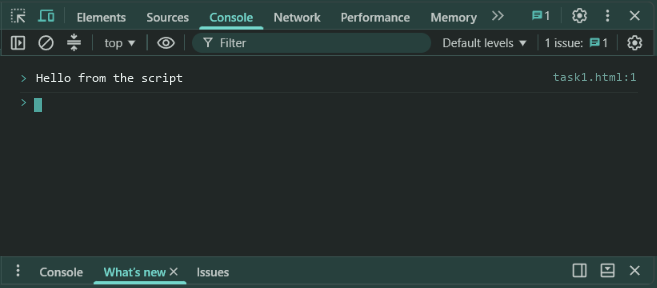
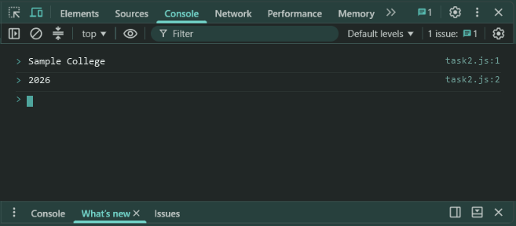
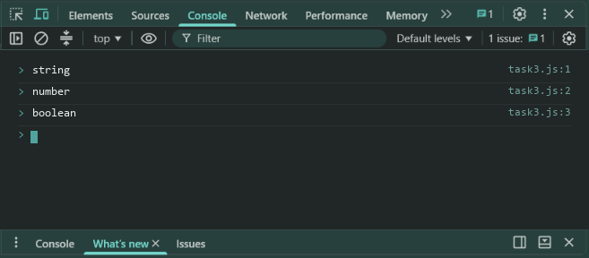

# Lab 1: Your First JavaScript Script

- **Student Name:** Abhinav Srivastava
- **Roll Number / Student ID:** `BCS2025376`
- **Section:** E
- **Subject:** JavaScript Programming Lab (BCS354)
- **Institution:** Invertis University, Bareilly

---

## Aim
Run a script in the browser and with Node, and declare values with const and let.

---

## Submission Requirement
> **Submit:** One .js file per task (or one .html file where a page is used) and a copy of its output.

---

## Tasks, Source Code & Output Screenshots
### Task 1 (`task1.html`)

```html
<!--
Name: Abhinav Srivastava
Roll Number / Student ID: BCS2025376
Section: E
Lab 1 - Task 1: Print Hello from the script
-->
<!DOCTYPE html>
<html>
<head>
  <title>Lab 1 - Task 1</title>
</head>
<body>

  <h1>Lab 1 - Task 1</h1>
  <p>Open browser console (F12) to view output.</p>
  <script>
    console.log("Hello from the script");
  </script>
</body>
</html>
```

**Output:**
```text
Hello from the script
```

**Output Screenshot:**


---

### Task 2 (`task2.js`)

```javascript
// Name: Abhinav Srivastava
// Roll Number / Student ID: BCS2025376
// Section: E
// Lab 1 - Task 2: Declare const and let variables

const schoolName = "Sample College";
let year = 2026;

console.log(schoolName);
console.log(year);
```

**Output:**
```text
Sample College
2026
```

**Output Screenshot:**


---

### Task 3 (`task3.js`)

```javascript
// Name: Abhinav Srivastava
// Roll Number / Student ID: BCS2025376
// Section: E
// Lab 1 - Task 3: Check types using typeof

console.log(typeof "hello");
console.log(typeof 7);
console.log(typeof true);
```

**Output:**
```text
string
number
boolean
```

**Output Screenshot:**


---

## Execution & Verification
- **Browser DevTools Console:** For HTML tasks, open the `.html` file in your browser and check the Console tab (`F12`). For JS tasks, scripts can be executed in the Console.
- **Node.js (Terminal):**
```bash
node task2.js
node task3.js
```
