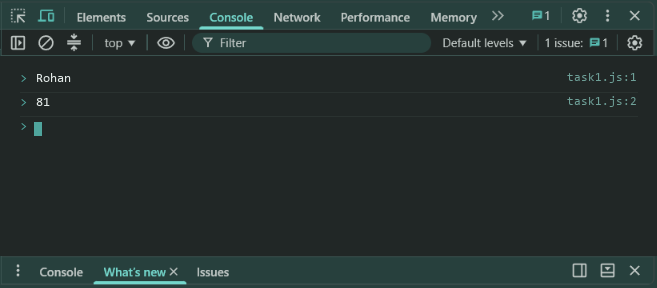
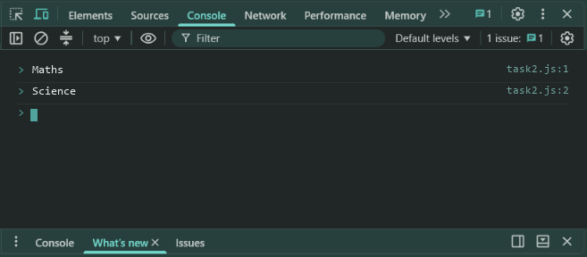

# Lab 10: Objects and Destructuring

- **Student Name:** Abhinav Srivastava
- **Roll Number / Student ID:** `BCS2025376`
- **Section:** E
- **Subject:** JavaScript Programming Lab (BCS354)
- **Institution:** Invertis University, Bareilly

---

## Aim
Create an object, read and change its properties, and take values out of an array and an object with destructuring.

---

## Submission Requirement
> **Submit:** One .js file per task (or one .html file where a page is used) and a copy of its output.

---

## Tasks, Source Code & Output Screenshots
### Task 1 (`task1.js`)

```javascript
// Name: Abhinav Srivastava
// Roll Number / Student ID: BCS2025376
// Section: E
// Lab 10 - Task 1: Create, access and modify object properties

let student = {
  name: "Rohan",
  roll: 12,
  marks: 78
};

console.log(student.name);
student.marks = 81;
console.log(student.marks);
```

**Output:**
```text
Rohan
81
```

**Output Screenshot:**


---

### Task 2 (`task2.js`)

```javascript
// Name: Abhinav Srivastava
// Roll Number / Student ID: BCS2025376
// Section: E
// Lab 10 - Task 2: Array destructuring

let subjects = ["Maths", "Science", "English"];
let [first, second] = subjects;

console.log(first);
console.log(second);
```

**Output:**
```text
Maths
Science
```

**Output Screenshot:**


---

### Task 3 (`task3.js`)

```javascript
// Name: Abhinav Srivastava
// Roll Number / Student ID: BCS2025376
// Section: E
// Lab 10 - Task 3: Object destructuring

let student = {
  name: "Rohan",
  roll: 12,
  marks: 81
};

let { name, roll } = student;
console.log(name);
console.log(roll);
```

**Output:**
```text
Rohan
12
```

**Output Screenshot:**


---

## Execution & Verification
- **Browser DevTools Console:** For HTML tasks, open the `.html` file in your browser and check the Console tab (`F12`). For JS tasks, scripts can be executed in the Console.
- **Node.js (Terminal):**
```bash
node task1.js
node task2.js
node task3.js
```
