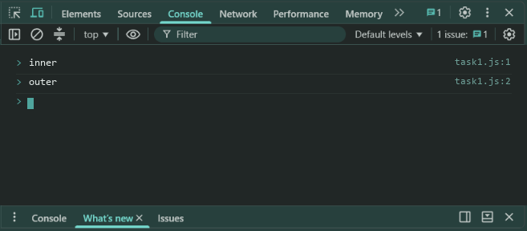
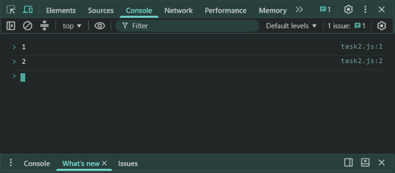
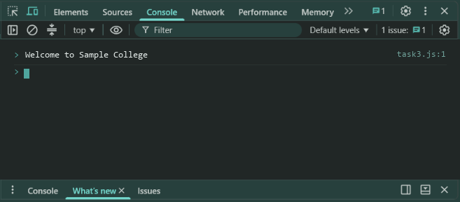

# Lab 11: Scope and Closures

- **Student Name:** Abhinav Srivastava
- **Roll Number / Student ID:** `BCS2025376`
- **Section:** E
- **Subject:** JavaScript Programming Lab (BCS354)
- **Institution:** Invertis University, Bareilly

---

## Aim
Explain block scope and global scope, and use a function that returns a function that keeps a value between calls.

---

## Submission Requirement
> **Submit:** One .js file per task (or one .html file where a page is used) and a copy of its output.

---

## Tasks, Source Code & Output Screenshots
### Task 1 (`task1.js`)

```javascript
// Name: Abhinav Srivastava
// Roll Number / Student ID: BCS2025376
// Section: E
// Lab 11 - Task 1: Block scope vs outer scope

let level = "outer";

{
  let level = "inner";
  console.log(level);
}

console.log(level);
```

**Output:**
```text
inner
outer
```

**Output Screenshot:**


---

### Task 2 (`task2.js`)

```javascript
// Name: Abhinav Srivastava
// Roll Number / Student ID: BCS2025376
// Section: E
// Lab 11 - Task 2: Closure counter function

function makeCounter() {
  let count = 0;
  return function() {
    count++;
    return count;
  };
}

let counter = makeCounter();
console.log(counter());
console.log(counter());
```

**Output:**
```text
1
2
```

**Output Screenshot:**


---

### Task 3 (`task3.js`)

```javascript
// Name: Abhinav Srivastava
// Roll Number / Student ID: BCS2025376
// Section: E
// Lab 11 - Task 3: Global scope access in function

let school = "Sample College";

function showSchool() {
  console.log("Welcome to " + school);
}

showSchool();
```

**Output:**
```text
Welcome to Sample College
```

**Output Screenshot:**


---

## Execution & Verification
- **Browser DevTools Console:** For HTML tasks, open the `.html` file in your browser and check the Console tab (`F12`). For JS tasks, scripts can be executed in the Console.
- **Node.js (Terminal):**
```bash
node task1.js
node task2.js
node task3.js
```
