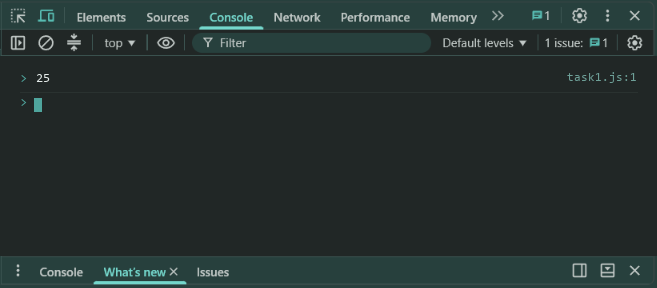
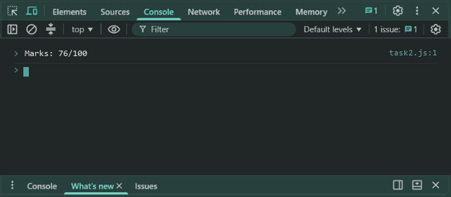
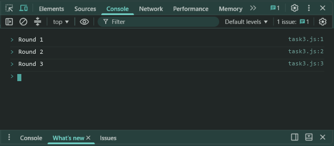

# Lab 12: Callbacks and Higher-Order Functions

- **Student Name:** Abhinav Srivastava
- **Roll Number / Student ID:** `BCS2025376`
- **Section:** E
- **Subject:** JavaScript Programming Lab (BCS354)
- **Institution:** Invertis University, Bareilly

---

## Aim
Pass a function as an argument to another function and call it.

---

## Submission Requirement
> **Submit:** One .js file per task (or one .html file where a page is used) and a copy of its output.

---

## Tasks, Source Code & Output Screenshots
### Task 1 (`task1.js`)

```javascript
// Name: Abhinav Srivastava
// Roll Number / Student ID: BCS2025376
// Section: E
// Lab 12 - Task 1: Higher-order function applyTwice

function applyTwice(fn, val) {
  return fn(fn(val));
}

function addTen(num) {
  return num + 10;
}

console.log(applyTwice(addTen, 5));
```

**Output:**
```text
25
```

**Output Screenshot:**


---

### Task 2 (`task2.js`)

```javascript
// Name: Abhinav Srivastava
// Roll Number / Student ID: BCS2025376
// Section: E
// Lab 12 - Task 2: Callback function formatMarks

function formatMarks(marks, callback) {
  return callback(marks);
}

console.log(formatMarks(76, (m) => "Marks: " + m + "/100"));
```

**Output:**
```text
Marks: 76/100
```

**Output Screenshot:**


---

### Task 3 (`task3.js`)

```javascript
// Name: Abhinav Srivastava
// Roll Number / Student ID: BCS2025376
// Section: E
// Lab 12 - Task 3: Repeat action with repeatAction

function repeatAction(times, action) {
  for (let i = 1; i <= times; i++) {
    action(i);
  }
}

repeatAction(3, (round) => console.log("Round " + round));
```

**Output:**
```text
Round 1
Round 2
Round 3
```

**Output Screenshot:**


---

## Execution & Verification
- **Browser DevTools Console:** For HTML tasks, open the `.html` file in your browser and check the Console tab (`F12`). For JS tasks, scripts can be executed in the Console.
- **Node.js (Terminal):**
```bash
node task1.js
node task2.js
node task3.js
```
