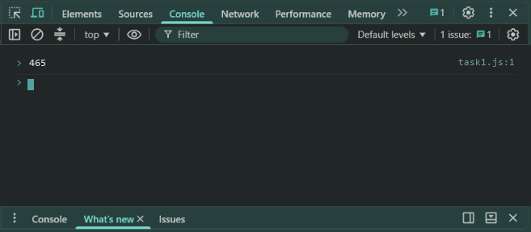
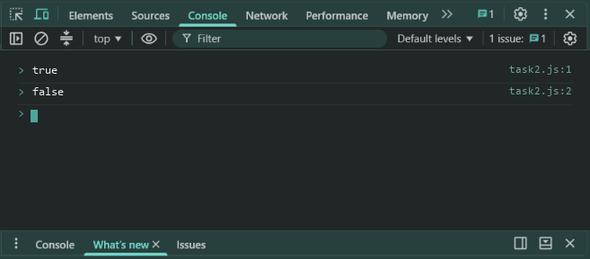
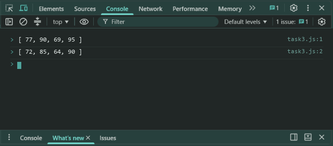

# Lab 13: Reduce, Some, Every and Map

- **Student Name:** Abhinav Srivastava
- **Roll Number / Student ID:** `BCS2025376`
- **Section:** E
- **Subject:** JavaScript Programming Lab (BCS354)
- **Institution:** Invertis University, Bareilly

---

## Aim
Use reduce, some, every and map on arrays, and keep the original array unchanged.

---

## Submission Requirement
> **Submit:** One .js file per task (or one .html file where a page is used) and a copy of its output.

---

## Tasks, Source Code & Output Screenshots
### Task 1 (`task1.js`)

```javascript
// Name: Abhinav Srivastava
// Roll Number / Student ID: BCS2025376
// Section: E
// Lab 13 - Task 1: Sum array elements with reduce

let prices = [120, 45, 300];
let total = prices.reduce((acc, curr) => acc + curr, 0);

console.log(total);
```

**Output:**
```text
465
```

**Output Screenshot:**


---

### Task 2 (`task2.js`)

```javascript
// Name: Abhinav Srivastava
// Roll Number / Student ID: BCS2025376
// Section: E
// Lab 13 - Task 2: Check conditions with some and every

let marks = [72, 85, 30, 90];

console.log(marks.some(m => m < 40));
console.log(marks.every(m => m >= 35));
```

**Output:**
```text
true
false
```

**Output Screenshot:**


---

### Task 3 (`task3.js`)

```javascript
// Name: Abhinav Srivastava
// Roll Number / Student ID: BCS2025376
// Section: E
// Lab 13 - Task 3: Transform array with map without modifying original

let marks = [72, 85, 64, 90];
let newMarks = marks.map(m => m + 5);

console.log(newMarks);
console.log(marks);
```

**Output:**
```text
[ 77, 90, 69, 95 ]
[ 72, 85, 64, 90 ]
```

**Output Screenshot:**


---

## Execution & Verification
- **Browser DevTools Console:** For HTML tasks, open the `.html` file in your browser and check the Console tab (`F12`). For JS tasks, scripts can be executed in the Console.
- **Node.js (Terminal):**
```bash
node task1.js
node task2.js
node task3.js
```
