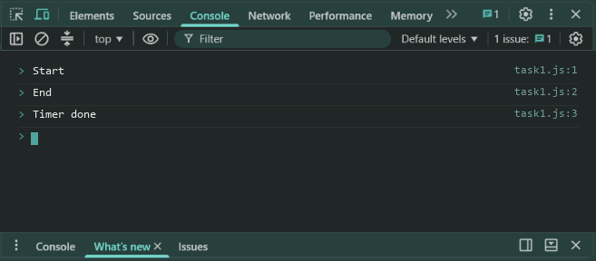
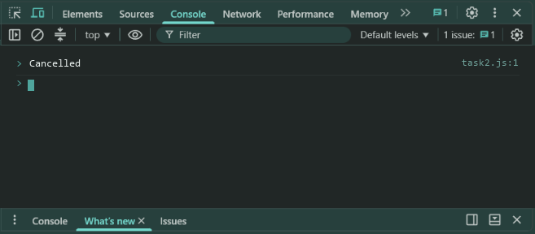
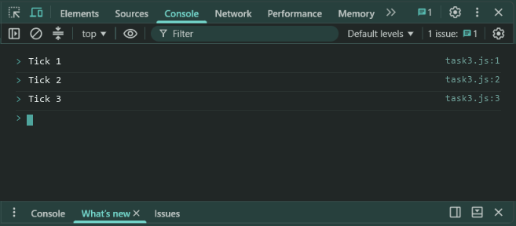

# Lab 14: Timers and Intervals

- **Student Name:** Abhinav Srivastava
- **Roll Number / Student ID:** `BCS2025376`
- **Section:** E
- **Subject:** JavaScript Programming Lab (BCS354)
- **Institution:** Invertis University, Bareilly

---

## Aim
Run code after a delay with setTimeout, cancel a timer, and repeat code with setInterval.

---

## Submission Requirement
> **Submit:** One .js file per task (or one .html file where a page is used) and a copy of its output.

---

## Tasks, Source Code & Output Screenshots
### Task 1 (`task1.js`)

```javascript
// Name: Abhinav Srivastava
// Roll Number / Student ID: BCS2025376
// Section: E
// Lab 14 - Task 1: setTimeout with 0ms delay

console.log("Start");

setTimeout(() => {
  console.log("Timer done");
}, 0);

console.log("End");
```

**Output:**
```text
Start
End
Timer done
```

**Output Screenshot:**


---

### Task 2 (`task2.js`)

```javascript
// Name: Abhinav Srivastava
// Roll Number / Student ID: BCS2025376
// Section: E
// Lab 14 - Task 2: Cancel timer with clearTimeout

let timerId = setTimeout(() => {
  console.log("Not shown");
}, 1000);

clearTimeout(timerId);
console.log("Cancelled");
```

**Output:**
```text
Cancelled
```

**Output Screenshot:**


---

### Task 3 (`task3.js`)

```javascript
// Name: Abhinav Srivastava
// Roll Number / Student ID: BCS2025376
// Section: E
// Lab 14 - Task 3: Repeat with setInterval and stop with clearInterval

let count = 0;
let intervalId = setInterval(() => {
  count++;
  console.log("Tick " + count);
  if (count === 3) {
    clearInterval(intervalId);
  }
}, 200);
```

**Output:**
```text
Tick 1
Tick 2
Tick 3
```

**Output Screenshot:**


---

## Execution & Verification
- **Browser DevTools Console:** For HTML tasks, open the `.html` file in your browser and check the Console tab (`F12`). For JS tasks, scripts can be executed in the Console.
- **Node.js (Terminal):**
```bash
node task1.js
node task2.js
node task3.js
```
