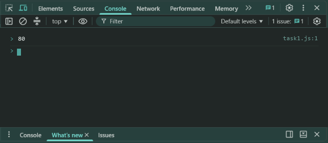
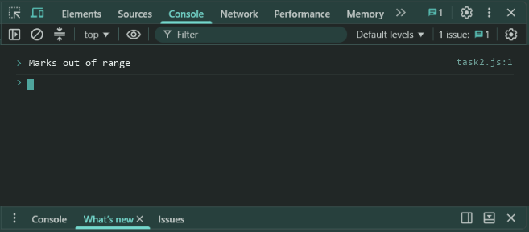
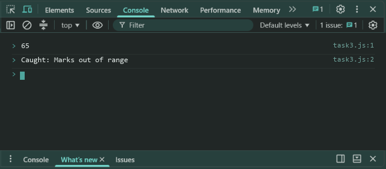
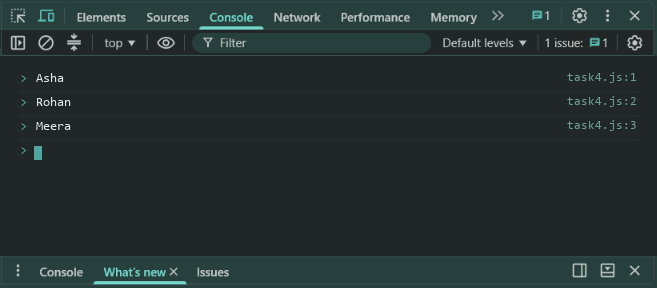

# Lab 15: Promises and async/await with Local Data

- **Student Name:** Abhinav Srivastava
- **Roll Number / Student ID:** `BCS2025376`
- **Section:** E
- **Subject:** JavaScript Programming Lab (BCS354)
- **Institution:** Invertis University, Bareilly

---

## Aim
Create a Promise that resolves or rejects, use async/await with try and catch, and load local data as a Promise.

---

## Submission Requirement
> **Submit:** One .js file per task (or one .html file where a page is used) and a copy of its output.

---

## Tasks, Source Code & Output Screenshots
### Task 1 (`task1.js`)

```javascript
// Name: Abhinav Srivastava
// Roll Number / Student ID: BCS2025376
// Section: E
// Lab 15 - Task 1: checkMarks Promise resolving with marks

function checkMarks(marks) {
  return new Promise((resolve, reject) => {
    if (marks >= 0 && marks <= 100) {
      resolve(marks);
    } else {
      reject(new Error("Marks out of range"));
    }
  });
}

checkMarks(80).then((val) => {
  console.log(val);
});
```

**Output:**
```text
80
```

**Output Screenshot:**


---

### Task 2 (`task2.js`)

```javascript
// Name: Abhinav Srivastava
// Roll Number / Student ID: BCS2025376
// Section: E
// Lab 15 - Task 2: checkMarks Promise rejecting with Error

function checkMarks(marks) {
  return new Promise((resolve, reject) => {
    if (marks >= 0 && marks <= 100) {
      resolve(marks);
    } else {
      reject(new Error("Marks out of range"));
    }
  });
}

checkMarks(120).catch((err) => {
  console.log(err.message);
});
```

**Output:**
```text
Marks out of range
```

**Output Screenshot:**


---

### Task 3 (`task3.js`)

```javascript
// Name: Abhinav Srivastava
// Roll Number / Student ID: BCS2025376
// Section: E
// Lab 15 - Task 3: async run with try-catch and await

function checkMarks(marks) {
  return new Promise((resolve, reject) => {
    if (marks >= 0 && marks <= 100) {
      resolve(marks);
    } else {
      reject(new Error("Marks out of range"));
    }
  });
}

async function run() {
  try {
    console.log(await checkMarks(65));
    await checkMarks(-5);
  } catch (err) {
    console.log("Caught: " + err.message);
  }
}

run();
```

**Output:**
```text
65
Caught: Marks out of range
```

**Output Screenshot:**


---

### Task 4 (`task4.js`)

```javascript
// Name: Abhinav Srivastava
// Roll Number / Student ID: BCS2025376
// Section: E
// Lab 15 - Task 4: Load local users with Promise and async-await

function getUsers() {
  return new Promise((resolve) => {
    setTimeout(() => {
      resolve([
        { id: 1, name: "Asha" },
        { id: 2, name: "Rohan" },
        { id: 3, name: "Meera" }
      ]);
    }, 100);
  });
}

async function printUsers() {
  let users = await getUsers();
  users.forEach((user) => {
    console.log(user.name);
  });
}

printUsers();
```

**Output:**
```text
Asha
Rohan
Meera
```

**Output Screenshot:**


---

## Execution & Verification
- **Browser DevTools Console:** For HTML tasks, open the `.html` file in your browser and check the Console tab (`F12`). For JS tasks, scripts can be executed in the Console.
- **Node.js (Terminal):**
```bash
node task1.js
node task2.js
node task3.js
node task4.js
```
