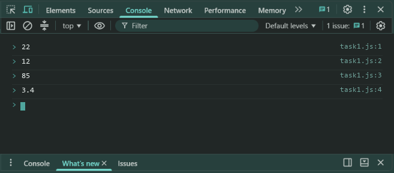
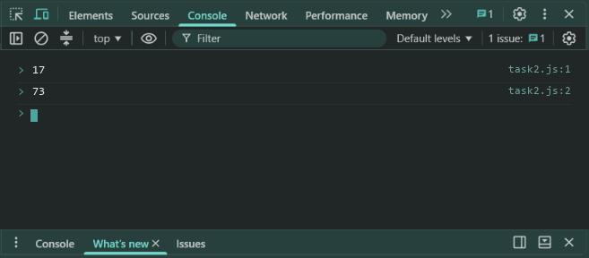

# Lab 2: Operators, Type Conversion and a Calculator

- **Student Name:** Abhinav Srivastava
- **Roll Number / Student ID:** `BCS2025376`
- **Section:** E
- **Subject:** JavaScript Programming Lab (BCS354)
- **Institution:** Invertis University, Bareilly

---

## Aim
Use arithmetic operators, convert between text and numbers, and use if and else if to choose an operation.

---

## Submission Requirement
> **Submit:** One .js file per task (or one .html file where a page is used) and a copy of its output.

---

## Tasks, Source Code & Output Screenshots
### Task 1 (`task1.js`)

```javascript
// Name: Abhinav Srivastava
// Roll Number / Student ID: BCS2025376
// Section: E
// Lab 2 - Task 1: Arithmetic operators on 17 and 5

let a = 17;
let b = 5;

console.log(a + b);
console.log(a - b);
console.log(a * b);
console.log(a / b);
```

**Output:**
```text
22
12
85
3.4
```

**Output Screenshot:**


---

### Task 2 (`task2.js`)

```javascript
// Name: Abhinav Srivastava
// Roll Number / Student ID: BCS2025376
// Section: E
// Lab 2 - Task 2: Type conversion between text and number

let textVal = "12";
let numResult = Number(textVal) + 5;
console.log(numResult);

let numVal = 7;
let textResult = String(numVal) + "3";
console.log(textResult);
```

**Output:**
```text
17
73
```

**Output Screenshot:**


---

### Task 3 (`task3.js`)

```javascript
// Name: Abhinav Srivastava
// Roll Number / Student ID: BCS2025376
// Section: E
// Lab 2 - Task 3: Calculator using if and else if

let num1 = 8;
let num2 = 4;
let operator = "+";

if (operator === "+") {
  console.log(num1 + num2);
} else if (operator === "-") {
  console.log(num1 - num2);
}

operator = "-";

if (operator === "+") {
  console.log(num1 + num2);
} else if (operator === "-") {
  console.log(num1 - num2);
}
```

**Output:**
```text
12
4
```

**Output Screenshot:**


---

## Execution & Verification
- **Browser DevTools Console:** For HTML tasks, open the `.html` file in your browser and check the Console tab (`F12`). For JS tasks, scripts can be executed in the Console.
- **Node.js (Terminal):**
```bash
node task1.js
node task2.js
node task3.js
```
