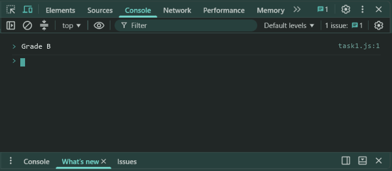
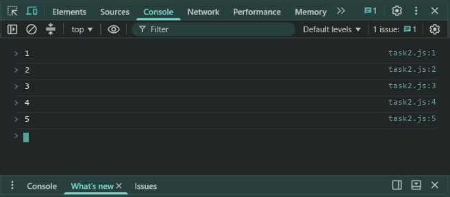
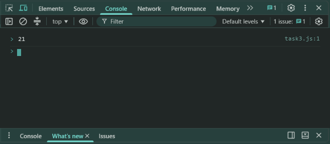

# Lab 3: Conditions and Loops

- **Student Name:** Abhinav Srivastava
- **Roll Number / Student ID:** `BCS2025376`
- **Section:** E
- **Subject:** JavaScript Programming Lab (BCS354)
- **Institution:** Invertis University, Bareilly

---

## Aim
Choose between cases with if, else if and else, and repeat work with a for loop and a while loop.

---

## Submission Requirement
> **Submit:** One .js file per task (or one .html file where a page is used) and a copy of its output.

---

## Tasks, Source Code & Output Screenshots
### Task 1 (`task1.js`)

```javascript
// Name: Abhinav Srivastava
// Roll Number / Student ID: BCS2025376
// Section: E
// Lab 3 - Task 1: Grade evaluation using if, else if and else

let marks = 72;

if (marks >= 75) {
  console.log("Grade A");
} else if (marks >= 60) {
  console.log("Grade B");
} else {
  console.log("Grade C");
}
```

**Output:**
```text
Grade B
```

**Output Screenshot:**


---

### Task 2 (`task2.js`)

```javascript
// Name: Abhinav Srivastava
// Roll Number / Student ID: BCS2025376
// Section: E
// Lab 3 - Task 2: Print numbers 1 to 5 using for loop

for (let i = 1; i <= 5; i++) {
  console.log(i);
}
```

**Output:**
```text
1
2
3
4
5
```

**Output Screenshot:**


---

### Task 3 (`task3.js`)

```javascript
// Name: Abhinav Srivastava
// Roll Number / Student ID: BCS2025376
// Section: E
// Lab 3 - Task 3: Add numbers until total > 20 using while loop

let total = 0;
let current = 1;

while (total <= 20) {
  total += current;
  current++;
}

console.log(total);
```

**Output:**
```text
21
```

**Output Screenshot:**


---

## Execution & Verification
- **Browser DevTools Console:** For HTML tasks, open the `.html` file in your browser and check the Console tab (`F12`). For JS tasks, scripts can be executed in the Console.
- **Node.js (Terminal):**
```bash
node task1.js
node task2.js
node task3.js
```
