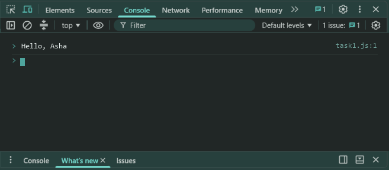
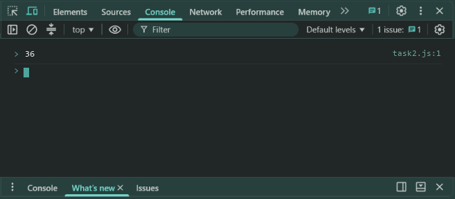

# Lab 4: Writing Functions

- **Student Name:** Abhinav Srivastava
- **Roll Number / Student ID:** `BCS2025376`
- **Section:** E
- **Subject:** JavaScript Programming Lab (BCS354)
- **Institution:** Invertis University, Bareilly

---

## Aim
Write a function with a return value, an arrow function, and a default parameter.

---

## Submission Requirement
> **Submit:** One .js file per task (or one .html file where a page is used) and a copy of its output.

---

## Tasks, Source Code & Output Screenshots
### Task 1 (`task1.js`)

```javascript
// Name: Abhinav Srivastava
// Roll Number / Student ID: BCS2025376
// Section: E
// Lab 4 - Task 1: Function greet returning greeting text

function greet(name) {
  return "Hello, " + name;
}

console.log(greet("Asha"));
```

**Output:**
```text
Hello, Asha
```

**Output Screenshot:**


---

### Task 2 (`task2.js`)

```javascript
// Name: Abhinav Srivastava
// Roll Number / Student ID: BCS2025376
// Section: E
// Lab 4 - Task 2: Arrow function square

const square = (n) => n * n;

console.log(square(6));
```

**Output:**
```text
36
```

**Output Screenshot:**


---

### Task 3 (`task3.js`)

```javascript
// Name: Abhinav Srivastava
// Roll Number / Student ID: BCS2025376
// Section: E
// Lab 4 - Task 3: Function billWithTax with default taxRate

function billWithTax(amount, taxRate = 0.18) {
  return amount + (amount * taxRate);
}

console.log(billWithTax(100));
```

**Output:**
```text
118
```

**Output Screenshot:**


---

## Execution & Verification
- **Browser DevTools Console:** For HTML tasks, open the `.html` file in your browser and check the Console tab (`F12`). For JS tasks, scripts can be executed in the Console.
- **Node.js (Terminal):**
```bash
node task1.js
node task2.js
node task3.js
```
