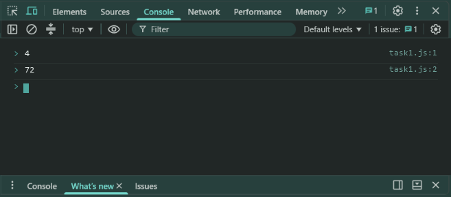
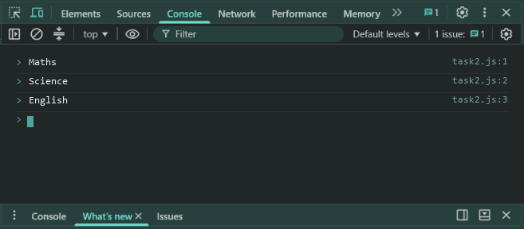
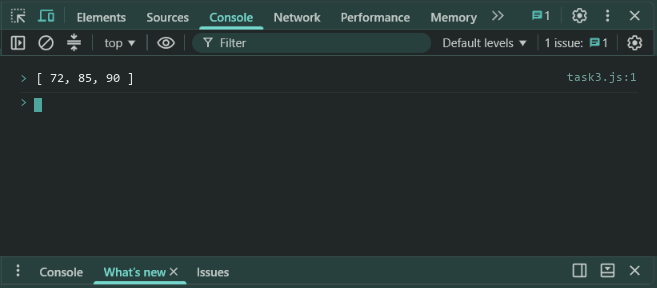
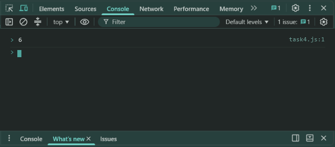

# Lab 5: Arrays, Array Methods and Nested Arrays

- **Student Name:** Abhinav Srivastava
- **Roll Number / Student ID:** `BCS2025376`
- **Section:** E
- **Subject:** JavaScript Programming Lab (BCS354)
- **Institution:** Invertis University, Bareilly

---

## Aim
Create an array, read its items, use forEach and filter, and read a value from an array inside an array.

---

## Submission Requirement
> **Submit:** One .js file per task (or one .html file where a page is used) and a copy of its output.

---

## Tasks, Source Code & Output Screenshots
### Task 1 (`task1.js`)

```javascript
// Name: Abhinav Srivastava
// Roll Number / Student ID: BCS2025376
// Section: E
// Lab 5 - Task 1: Array length and first item

let marks = [72, 85, 64, 90];

console.log(marks.length);
console.log(marks[0]);
```

**Output:**
```text
4
72
```

**Output Screenshot:**


---

### Task 2 (`task2.js`)

```javascript
// Name: Abhinav Srivastava
// Roll Number / Student ID: BCS2025376
// Section: E
// Lab 5 - Task 2: Iterate subjects array using forEach

let subjects = ["Maths", "Science", "English"];

subjects.forEach(subject => {
  console.log(subject);
});
```

**Output:**
```text
Maths
Science
English
```

**Output Screenshot:**


---

### Task 3 (`task3.js`)

```javascript
// Name: Abhinav Srivastava
// Roll Number / Student ID: BCS2025376
// Section: E
// Lab 5 - Task 3: Filter marks of 60 or more

let marks = [72, 85, 45, 90];
let filteredMarks = marks.filter(mark => mark >= 60);

console.log(filteredMarks);
```

**Output:**
```text
[ 72, 85, 90 ]
```

**Output Screenshot:**


---

### Task 4 (`task4.js`)

```javascript
// Name: Abhinav Srivastava
// Roll Number / Student ID: BCS2025376
// Section: E
// Lab 5 - Task 4: Read row 2 column 3 from nested array grid

let grid = [
  [1, 2, 3],
  [4, 5, 6]
];

console.log(grid[1][2]);
```

**Output:**
```text
6
```

**Output Screenshot:**


---

## Execution & Verification
- **Browser DevTools Console:** For HTML tasks, open the `.html` file in your browser and check the Console tab (`F12`). For JS tasks, scripts can be executed in the Console.
- **Node.js (Terminal):**
```bash
node task1.js
node task2.js
node task3.js
node task4.js
```
