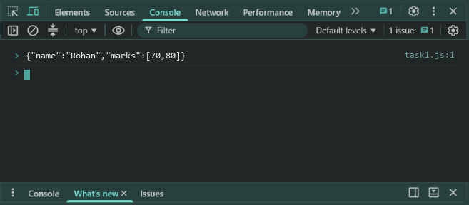
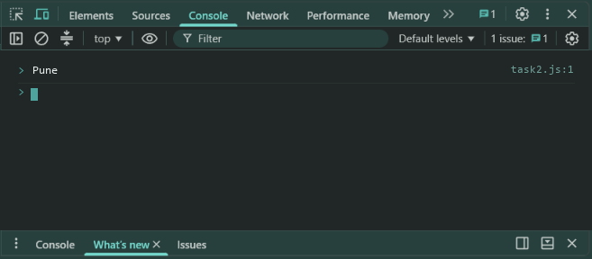
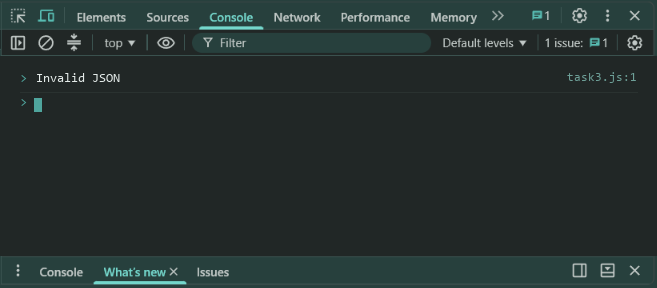

# Lab 6: JSON Text

- **Student Name:** Abhinav Srivastava
- **Roll Number / Student ID:** `BCS2025376`
- **Section:** E
- **Subject:** JavaScript Programming Lab (BCS354)
- **Institution:** Invertis University, Bareilly

---

## Aim
Convert an object to JSON text, convert JSON text back to an object, and catch invalid JSON.

---

## Submission Requirement
> **Submit:** One .js file per task (or one .html file where a page is used) and a copy of its output.

---

## Tasks, Source Code & Output Screenshots
### Task 1 (`task1.js`)

```javascript
// Name: Abhinav Srivastava
// Roll Number / Student ID: BCS2025376
// Section: E
// Lab 6 - Task 1: Convert object to JSON string using JSON.stringify

let student = {
  name: "Rohan",
  marks: [70, 80]
};

let jsonText = JSON.stringify(student);
console.log(jsonText);
```

**Output:**
```text
{"name":"Rohan","marks":[70,80]}
```

**Output Screenshot:**


---

### Task 2 (`task2.js`)

```javascript
// Name: Abhinav Srivastava
// Roll Number / Student ID: BCS2025376
// Section: E
// Lab 6 - Task 2: Parse JSON string using JSON.parse

let jsonString = '{"city":"Pune","pin":411001}';
let parsedObj = JSON.parse(jsonString);

console.log(parsedObj.city);
```

**Output:**
```text
Pune
```

**Output Screenshot:**


---

### Task 3 (`task3.js`)

```javascript
// Name: Abhinav Srivastava
// Roll Number / Student ID: BCS2025376
// Section: E
// Lab 6 - Task 3: Catch invalid JSON with try-catch

let invalidJson = "{name: Rohan}";

try {
  JSON.parse(invalidJson);
} catch (error) {
  console.log("Invalid JSON");
}
```

**Output:**
```text
Invalid JSON
```

**Output Screenshot:**


---

## Execution & Verification
- **Browser DevTools Console:** For HTML tasks, open the `.html` file in your browser and check the Console tab (`F12`). For JS tasks, scripts can be executed in the Console.
- **Node.js (Terminal):**
```bash
node task1.js
node task2.js
node task3.js
```
