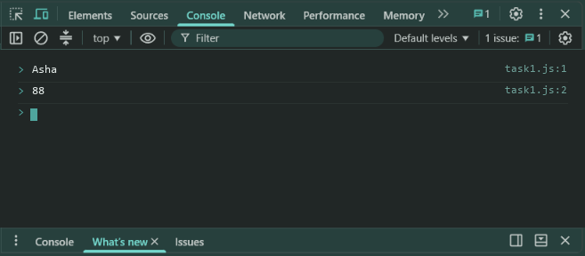
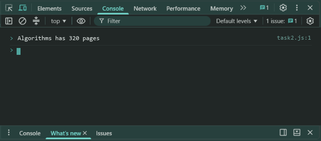
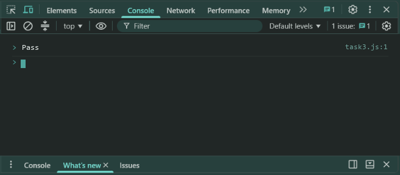

# Lab 7: Constructor Functions and Classes

- **Student Name:** Abhinav Srivastava
- **Roll Number / Student ID:** `BCS2025376`
- **Section:** E
- **Subject:** JavaScript Programming Lab (BCS354)
- **Institution:** Invertis University, Bareilly

---

## Aim
Create objects with a constructor function and with an ES6 class, and add a method through the prototype.

---

## Submission Requirement
> **Submit:** One .js file per task (or one .html file where a page is used) and a copy of its output.

---

## Tasks, Source Code & Output Screenshots
### Task 1 (`task1.js`)

```javascript
// Name: Abhinav Srivastava
// Roll Number / Student ID: BCS2025376
// Section: E
// Lab 7 - Task 1: Student constructor function

function Student(name, marks) {
  this.name = name;
  this.marks = marks;
}

let student1 = new Student("Asha", 88);
console.log(student1.name);
console.log(student1.marks);
```

**Output:**
```text
Asha
88
```

**Output Screenshot:**


---

### Task 2 (`task2.js`)

```javascript
// Name: Abhinav Srivastava
// Roll Number / Student ID: BCS2025376
// Section: E
// Lab 7 - Task 2: ES6 Book class with summary method

class Book {
  constructor(title, pages) {
    this.title = title;
    this.pages = pages;
  }
  summary() {
    return this.title + " has " + this.pages + " pages";
  }
}

let book = new Book("Algorithms", 320);
console.log(book.summary());
```

**Output:**
```text
Algorithms has 320 pages
```

**Output Screenshot:**


---

### Task 3 (`task3.js`)

```javascript
// Name: Abhinav Srivastava
// Roll Number / Student ID: BCS2025376
// Section: E
// Lab 7 - Task 3: Add result method to Student.prototype

function Student(name, marks) {
  this.name = name;
  this.marks = marks;
}

Student.prototype.result = function() {
  return this.marks >= 40 ? "Pass" : "Fail";
};

let asha = new Student("Asha", 88);
console.log(asha.result());
```

**Output:**
```text
Pass
```

**Output Screenshot:**


---

## Execution & Verification
- **Browser DevTools Console:** For HTML tasks, open the `.html` file in your browser and check the Console tab (`F12`). For JS tasks, scripts can be executed in the Console.
- **Node.js (Terminal):**
```bash
node task1.js
node task2.js
node task3.js
```
