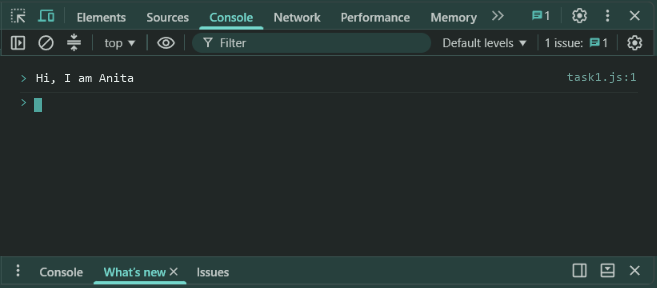
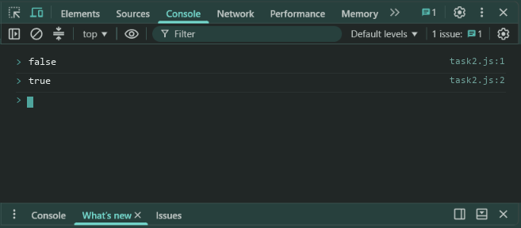
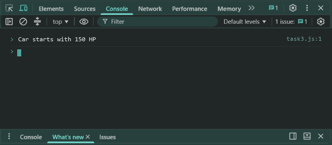

# Lab 8: Inheritance, Methods and Composition

- **Student Name:** Abhinav Srivastava
- **Roll Number / Student ID:** `BCS2025376`
- **Section:** E
- **Subject:** JavaScript Programming Lab (BCS354)
- **Institution:** Invertis University, Bareilly

---

## Aim
Use extends to make a child class, write a method that checks a value, and place one object inside another.

---

## Submission Requirement
> **Submit:** One .js file per task (or one .html file where a page is used) and a copy of its output.

---

## Tasks, Source Code & Output Screenshots
### Task 1 (`task1.js`)

```javascript
// Name: Abhinav Srivastava
// Roll Number / Student ID: BCS2025376
// Section: E
// Lab 8 - Task 1: Class inheritance Teacher extends Person

class Person {
  constructor(name) {
    this.name = name;
  }
  greet() {
    return "Hi, I am " + this.name;
  }
}

class Teacher extends Person {
  constructor(name, subject) {
    super(name);
    this.subject = subject;
  }
}

let anita = new Teacher("Anita", "Maths");
console.log(anita.greet());
```

**Output:**
```text
Hi, I am Anita
```

**Output Screenshot:**


---

### Task 2 (`task2.js`)

```javascript
// Name: Abhinav Srivastava
// Roll Number / Student ID: BCS2025376
// Section: E
// Lab 8 - Task 2: Class Locker with checkPin method

class Locker {
  constructor() {
    this.pin = 1234;
  }
  checkPin(num) {
    return num === this.pin;
  }
}

let locker = new Locker();
console.log(locker.checkPin(1111));
console.log(locker.checkPin(1234));
```

**Output:**
```text
false
true
```

**Output Screenshot:**


---

### Task 3 (`task3.js`)

```javascript
// Name: Abhinav Srivastava
// Roll Number / Student ID: BCS2025376
// Section: E
// Lab 8 - Task 3: Object composition Engine inside Car

class Engine {
  constructor(power) {
    this.power = power;
  }
}

class Car {
  constructor(power) {
    this.engine = new Engine(power);
  }
  start() {
    return "Car starts with " + this.engine.power + " HP";
  }
}

let car = new Car(150);
console.log(car.start());
```

**Output:**
```text
Car starts with 150 HP
```

**Output Screenshot:**


---

## Execution & Verification
- **Browser DevTools Console:** For HTML tasks, open the `.html` file in your browser and check the Console tab (`F12`). For JS tasks, scripts can be executed in the Console.
- **Node.js (Terminal):**
```bash
node task1.js
node task2.js
node task3.js
```
