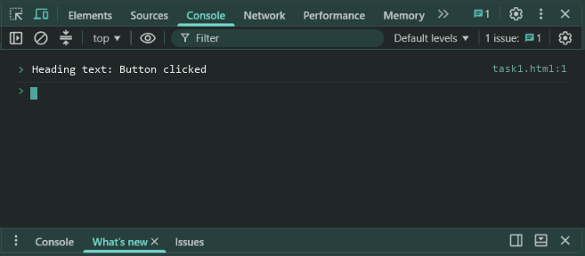
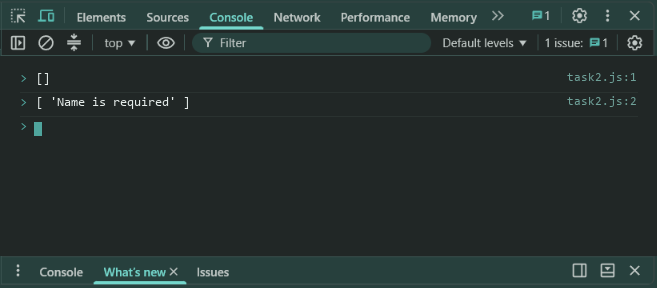
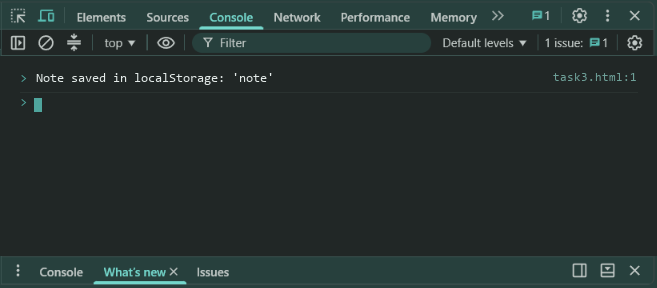
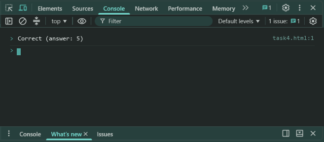

# Lab 9: DOM, Validation, Storage and Quiz

- **Student Name:** Abhinav Srivastava
- **Roll Number / Student ID:** `BCS2025376`
- **Section:** E
- **Subject:** JavaScript Programming Lab (BCS354)
- **Institution:** Invertis University, Bareilly

---

## Aim
Change a page with a click, check form values in code, save text in local storage, and build a small quiz.

---

## Submission Requirement
> **Submit:** One .js file per task (or one .html file where a page is used) and a copy of its output.

---

## Tasks, Source Code & Output Screenshots
### Task 1 (`task1.html`)

```html
<!--
Name: Abhinav Srivastava
Roll Number / Student ID: BCS2025376
Section: E
Lab 9 - Task 1: Button click changes heading text
-->
<!DOCTYPE html>
<html>
<head>
  <title>Lab 9 - Task 1</title>
</head>
<body>

  <h1 id="heading">Welcome</h1>
  <button id="btn">Change text</button>

  <script>
    const btn = document.getElementById("btn");
    const heading = document.getElementById("heading");
    btn.addEventListener("click", () => {
      heading.textContent = "Button clicked";
    });
  </script>
</body>
</html>
```

**Output:**
```text
Heading text: Button clicked
```

**Output Screenshot:**


---

### Task 2 (`task2.js`)

```javascript
// Name: Abhinav Srivastava
// Roll Number / Student ID: BCS2025376
// Section: E
// Lab 9 - Task 2: Form validation function validateForm

function validateForm(name) {
  let errors = [];
  if (!name || name.trim() === "") {
    errors.push("Name is required");
  }
  return errors;
}

console.log(validateForm("Asha"));
console.log(validateForm(""));
```

**Output:**
```text
[]
[ 'Name is required' ]
```

**Output Screenshot:**


---

### Task 3 (`task3.html`)

```html
<!--
Name: Abhinav Srivastava
Roll Number / Student ID: BCS2025376
Section: E
Lab 9 - Task 3: LocalStorage note persistence
-->
<!DOCTYPE html>
<html>
<head>
  <title>Lab 9 - Task 3</title>
</head>
<body>

  <h2>Local Storage Note</h2>
  <input type="text" id="noteBox" placeholder="Type a note...">
  <button id="saveBtn">Save</button>

  <script>
    const noteBox = document.getElementById("noteBox");
    const saveBtn = document.getElementById("saveBtn");

    // Show saved note on page open
    noteBox.value = localStorage.getItem("note") || "";

    // Save note to localStorage on click
    saveBtn.addEventListener("click", () => {
      localStorage.setItem("note", noteBox.value);
    });
  </script>
</body>
</html>
```

**Output:**
```text
Note saved in localStorage: 'note'
```

**Output Screenshot:**


---

### Task 4 (`task4.html`)

```html
<!--
Name: Abhinav Srivastava
Roll Number / Student ID: BCS2025376
Section: E
Lab 9 - Task 4: Simple Quiz with radio buttons
-->
<!DOCTYPE html>
<html>
<head>
  <title>Lab 9 - Task 4</title>
</head>
<body>

  <p>What is 2 + 3?</p>
  <label><input type="radio" name="ans" value="4"> 4</label><br>
  <label><input type="radio" name="ans" value="5"> 5</label><br>
  <label><input type="radio" name="ans" value="6"> 6</label><br><br>
  <button id="checkBtn">Check answer</button>
  <p id="quizResult"></p>

  <script>
    const checkBtn = document.getElementById("checkBtn");
    const resultText = document.getElementById("quizResult");

    checkBtn.addEventListener("click", () => {
      const selected = document.querySelector('input[name="ans"]:checked');
      if (selected && selected.value === "5") {
        resultText.textContent = "Correct";
      } else {
        resultText.textContent = "Try again";
      }
    });
  </script>
</body>
</html>
```

**Output:**
```text
Correct (answer: 5)
```

**Output Screenshot:**


---

## Execution & Verification
- **Browser DevTools Console:** For HTML tasks, open the `.html` file in your browser and check the Console tab (`F12`). For JS tasks, scripts can be executed in the Console.
- **Node.js (Terminal):**
```bash
node task2.js
```
